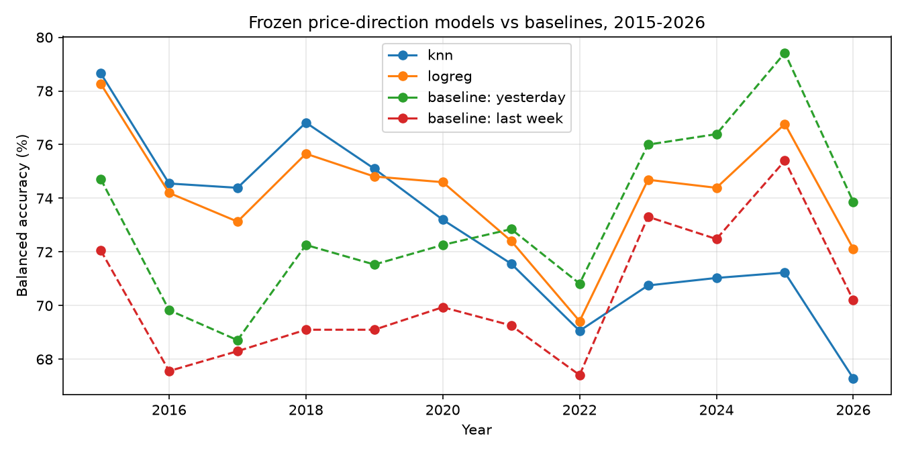
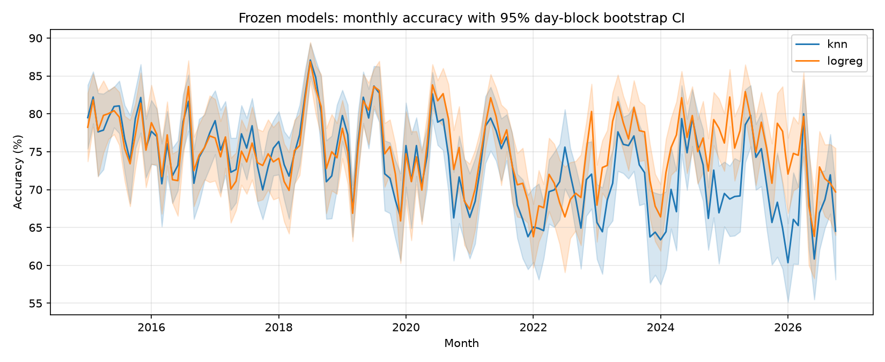
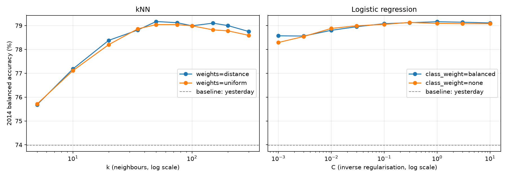
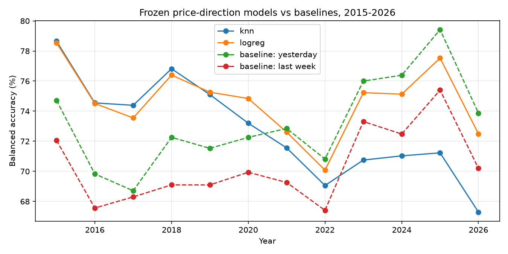
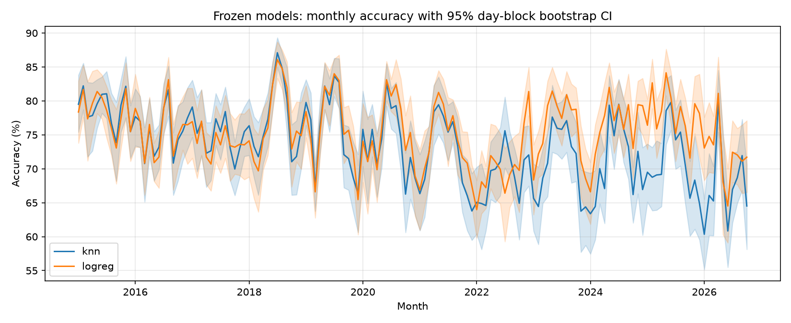
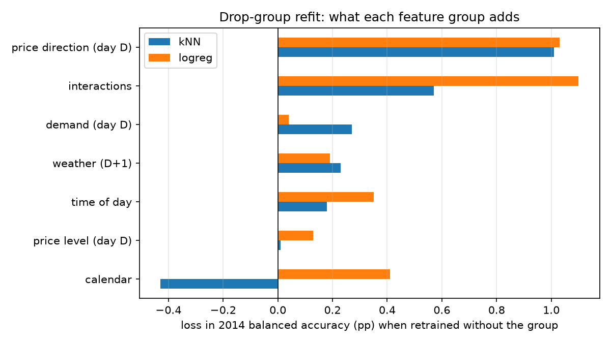
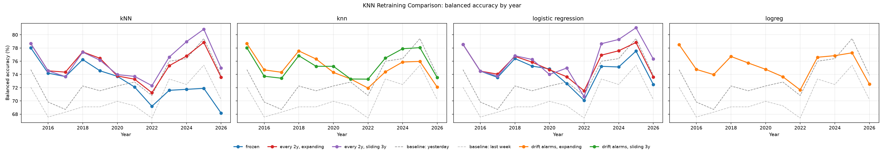
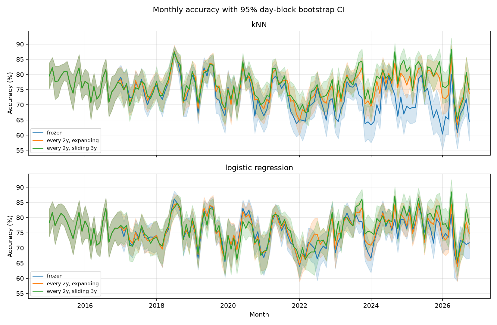
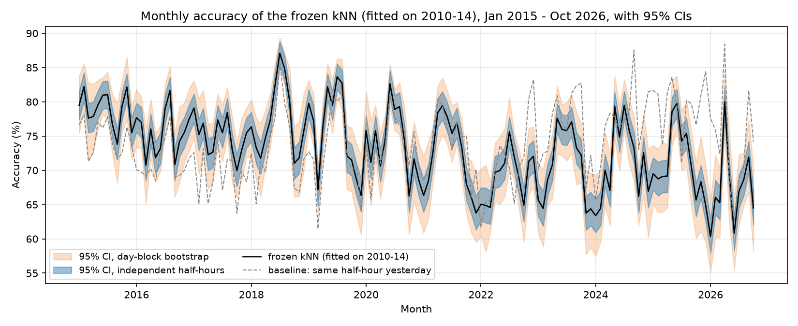

# Price-direction results

Each section below is written by the script named in it; rerun the command to regenerate it. Notes outside the BEGIN/END markers are kept.

## Stage 1 conclusion

- **Model: kNN, k=50, distance weighting, all 47 shared features**, fitted on 2010-14 and frozen for Stage 2. It ties logistic regression on 2014 (79.17 vs 79.16 balanced accuracy, both about 5 points above the yesterday baseline) and, because its training set is the model, it is the more natural base for the adaptation strategies.
- **Tuning** is flat around the defaults: across the kNN grid, k from 35 to 150 stays within about half a point (see "Stage 1 hyperparameter search").
- **Features: keep all 47.** Removing a group and retraining shows where the signal is: price direction (about 1 point lost for both models) and the interaction terms (0.6 for kNN, 1.1 for logistic regression). Every other group changes 2014 by under half a point either way (dropping calendar gains 0.43 for kNN), which is within noise, so there is no Stage 1 evidence for removing anything. The calendar features are also motivated in advance (weekday and holiday price patterns). The features overlap, but none hurts.
- The frozen 2015-26 numbers are reported for the Stage 2 discussion only; they were not used to make these choices.

<!-- BEGIN untuned -->
## Before tuning: frozen models on the shared 47 features (k=50 distance, C=1)

`python classification/analysis.py --section untuned --title "Before tuning: frozen models on the shared 47 features (k=50 distance, C=1)"` (2026-11-16 22:32, code 9386f29-dirty)

Models (224,976 shared half-hours, identical labels):

| predictions file | model | params | features |
|---|---|---|---|
| knn | kNN | k=50, weights=distance | 47 |
| logreg | logistic regression | C=1.0, class_weight=none | 47 |

**Stage 1 validation**: fitted on 2010-13, scored on 2014.

| 2014 | Acc % | BalAcc % |
|---|---|---|
| knn | 79.18 | 79.17 |
| logreg | 79.08 | 79.09 |
| baseline: yesterday | 73.9 | 73.99 |
| baseline: last week | 74.25 | 74.28 |

**Frozen models**: fitted on 2010-14, balanced accuracy % by year.

| year | knn | logreg | baseline: yesterday | baseline: last week | class-1 share |
|---|---|---|---|---|---|
| 2015 | 78.66 | 78.27 | 74.72 | 72.06 | 0.457 |
| 2016 | 74.55 | 74.2 | 69.83 | 67.56 | 0.396 |
| 2017 | 74.39 | 73.13 | 68.71 | 68.3 | 0.421 |
| 2018 | 76.82 | 75.66 | 72.26 | 69.1 | 0.404 |
| 2019 | 75.1 | 74.81 | 71.53 | 69.1 | 0.404 |
| 2020 | 73.2 | 74.6 | 72.26 | 69.94 | 0.387 |
| 2021 | 71.56 | 72.41 | 72.85 | 69.26 | 0.413 |
| 2022 | 69.06 | 69.42 | 70.82 | 67.41 | 0.482 |
| 2023 | 70.75 | 74.69 | 76.0 | 73.31 | 0.459 |
| 2024 | 71.03 | 74.39 | 76.39 | 72.48 | 0.433 |
| 2025 | 71.23 | 76.77 | 79.42 | 75.4 | 0.464 |
| 2026 | 67.29 | 72.12 | 73.87 | 70.2 | 0.519 |

<!-- END untuned -->

<!-- BEGIN tuning -->
## Stage 1 hyperparameter search (2014)

`python classification/stage1/tune.py` (2026-11-17 15:32, code 9386f29-dirty)

Fitted on 2010-13, scored on 2014; 47 shared features. Balanced accuracy %.

| model | before | best |
|---|---|---|
| kNN | k=50, distance: 79.17 | k=50, distance: 79.17 |
| logistic regression | C=1, class_weight=none: 79.09 | C=1.0, class_weight=balanced: 79.16 |

kNN (rows k, columns weighting):

| k | distance | uniform |
|---|---|---|
| 5 | 75.68 | 75.71 |
| 10 | 77.18 | 77.11 |
| 20 | 78.38 | 78.2 |
| 35 | 78.81 | 78.86 |
| 50 | 79.17 | 79.04 |
| 75 | 79.12 | 79.04 |
| 100 | 78.99 | 78.99 |
| 150 | 79.1 | 78.82 |
| 200 | 79.0 | 78.78 |
| 300 | 78.75 | 78.59 |

Logistic regression (rows C, columns class weighting):

| C | balanced | none |
|---|---|---|
| 0.001 | 78.57 | 78.29 |
| 0.003 | 78.56 | 78.54 |
| 0.01 | 78.8 | 78.88 |
| 0.03 | 78.95 | 78.99 |
| 0.1 | 79.08 | 79.05 |
| 0.3 | 79.12 | 79.13 |
| 1.0 | 79.16 | 79.09 |
| 3.0 | 79.14 | 79.08 |
| 10.0 | 79.11 | 79.08 |

<!-- END tuning -->

<!-- BEGIN tuned -->
## After tuning: frozen models with the best 2014 settings

`python classification/analysis.py --section tuned --title "After tuning: frozen models with the best 2014 settings"` (2026-11-16 22:36, code 9386f29-dirty)

Models (224,976 shared half-hours, identical labels):

| predictions file | model | params | features |
|---|---|---|---|
| knn | kNN | k=50, weights=distance | 47 |
| logreg | logistic regression | C=1.0, class_weight=balanced | 47 |

**Stage 1 validation**: fitted on 2010-13, scored on 2014.

| 2014 | Acc % | BalAcc % |
|---|---|---|
| knn | 79.18 | 79.17 |
| logreg | 79.09 | 79.16 |
| baseline: yesterday | 73.9 | 73.99 |
| baseline: last week | 74.25 | 74.28 |

**Frozen models**: fitted on 2010-14, balanced accuracy % by year.

| year | knn | logreg | baseline: yesterday | baseline: last week | class-1 share |
|---|---|---|---|---|---|
| 2015 | 78.66 | 78.55 | 74.72 | 72.06 | 0.457 |
| 2016 | 74.55 | 74.51 | 69.83 | 67.56 | 0.396 |
| 2017 | 74.39 | 73.55 | 68.71 | 68.3 | 0.421 |
| 2018 | 76.82 | 76.4 | 72.26 | 69.1 | 0.404 |
| 2019 | 75.1 | 75.26 | 71.53 | 69.1 | 0.404 |
| 2020 | 73.2 | 74.84 | 72.26 | 69.94 | 0.387 |
| 2021 | 71.56 | 72.61 | 72.85 | 69.26 | 0.413 |
| 2022 | 69.06 | 70.08 | 70.82 | 67.41 | 0.482 |
| 2023 | 70.75 | 75.23 | 76.0 | 73.31 | 0.459 |
| 2024 | 71.03 | 75.13 | 76.39 | 72.48 | 0.433 |
| 2025 | 71.23 | 77.53 | 79.42 | 75.4 | 0.464 |
| 2026 | 67.29 | 72.49 | 73.87 | 70.2 | 0.519 |

<!-- END tuned -->

<!-- BEGIN importance -->
## Feature-group importance: drop-group refit (2014)

`python classification/stage1/importance.py` (2026-11-17 15:47, code 9386f29-dirty)

Both models fitted on 2010-13 (47 shared features). Each group is removed in
turn, the model is retrained without it, and the loss in 2014 balanced accuracy against the
full model is recorded (percentage points; near zero or negative = no measurable
contribution). Groups are removed rather than single features because correlated features
cover for each other: removing one lets the model lean on its near-duplicate.

| group removed | kNN | logreg | features |
|---|---|---|---|
| price direction (day D) | 1.01 | 1.03 | 3.0 |
| interactions | 0.57 | 1.1 | 23.0 |
| demand (day D) | 0.27 | 0.04 | 2.0 |
| weather (D+1) | 0.23 | 0.19 | 4.0 |
| time of day | 0.18 | 0.35 | 2.0 |
| price level (day D) | 0.01 | 0.13 | 3.0 |
| calendar | -0.43 | 0.41 | 10.0 |

<!-- END importance -->

<!-- BEGIN adaptation -->
## Retrained every 2 years

`python classification/analysis.py --section adaptation --title "Retrained every 2 years"` (2026-11-17 17:08, code 9f91686-dirty)

Models (224,976 shared half-hours, identical labels):

| predictions file | model | params | features | retrains |
|---|---|---|---|---|
| knn | kNN | k=50, weights=distance | 47 | none (frozen) |
| knn_every2y_expanding | kNN | k=50, weights=distance | 47 | 2017-01-01, 2019-01-01, 2021-01-01, 2023-01-01, 2025-01-01 |
| knn_every2y_sliding3y | kNN | k=50, weights=distance | 47 | 2017-01-01, 2019-01-01, 2021-01-01, 2023-01-01, 2025-01-01 |
| logreg | logistic regression | C=1.0, class_weight=balanced | 47 | none (frozen) |
| logreg_every2y_expanding | logistic regression | C=1.0, class_weight=balanced | 47 | 2017-01-01, 2019-01-01, 2021-01-01, 2023-01-01, 2025-01-01 |
| logreg_every2y_sliding3y | logistic regression | C=1.0, class_weight=balanced | 47 | 2017-01-01, 2019-01-01, 2021-01-01, 2023-01-01, 2025-01-01 |

**Stage 1 validation**: fitted on 2010-13, scored on 2014.

| 2014 | Acc % | BalAcc % |
|---|---|---|
| knn | 79.18 | 79.17 |
| knn_every2y_expanding | 79.18 | 79.17 |
| knn_every2y_sliding3y | 79.18 | 79.17 |
| logreg | 79.09 | 79.16 |
| logreg_every2y_expanding | 79.09 | 79.16 |
| logreg_every2y_sliding3y | 79.09 | 79.16 |
| baseline: yesterday | 73.9 | 73.99 |
| baseline: last week | 74.25 | 74.28 |

**2015-26 replay**: balanced accuracy % by year. Models without a strategy are frozen (fitted on 2010-14); retrained ones list their dates in the models table.

| year | knn | knn_every2y_expanding | knn_every2y_sliding3y | logreg | logreg_every2y_expanding | logreg_every2y_sliding3y | baseline: yesterday | baseline: last week | class-1 share |
|---|---|---|---|---|---|---|---|---|---|
| 2015 | 78.66 | 78.66 | 78.66 | 78.55 | 78.55 | 78.55 | 74.72 | 72.06 | 0.457 |
| 2016 | 74.55 | 74.55 | 74.55 | 74.51 | 74.51 | 74.51 | 69.83 | 67.56 | 0.396 |
| 2017 | 74.39 | 74.35 | 73.67 | 73.55 | 74.04 | 73.75 | 68.71 | 68.3 | 0.421 |
| 2018 | 76.82 | 77.41 | 77.37 | 76.4 | 76.74 | 76.83 | 72.26 | 69.1 | 0.404 |
| 2019 | 75.1 | 76.44 | 76.15 | 75.26 | 75.85 | 76.26 | 71.53 | 69.1 | 0.404 |
| 2020 | 73.2 | 73.77 | 73.97 | 74.84 | 74.71 | 74.0 | 72.26 | 69.94 | 0.387 |
| 2021 | 71.56 | 73.28 | 73.71 | 72.61 | 73.65 | 74.97 | 72.85 | 69.26 | 0.413 |
| 2022 | 69.06 | 71.24 | 72.3 | 70.08 | 71.53 | 70.65 | 70.82 | 67.41 | 0.482 |
| 2023 | 70.75 | 75.32 | 76.63 | 75.23 | 76.92 | 78.65 | 76.0 | 73.31 | 0.459 |
| 2024 | 71.03 | 76.78 | 78.96 | 75.13 | 77.58 | 79.29 | 76.39 | 72.48 | 0.433 |
| 2025 | 71.23 | 78.85 | 80.84 | 77.53 | 78.83 | 81.06 | 79.42 | 75.4 | 0.464 |
| 2026 | 67.29 | 73.58 | 74.98 | 72.49 | 73.62 | 76.33 | 73.87 | 70.2 | 0.519 |

<!-- END adaptation -->

<!-- BEGIN frozen_ci_knn -->
## Frozen monthly accuracy with 95% CIs: knn

`python classification/stage2/frozen_ci.py --name knn` (2026-11-21 12:59, code 3bfcea2)

Monthly accuracy (%) of `knn` over the frozen replay, with 95% CIs computed both ways
(Appendix A). Mean CI width: **4.49 pp** treating half-hours as independent,
**9.16 pp** with the day-block bootstrap (**2.0x** wider),
because errors within a day are correlated. The model is below the yesterday baseline in
66 of 142 months.

| year | mean monthly accuracy % |
|---|---|
| 2015 | 78.86 |
| 2016 | 75.44 |
| 2017 | 74.91 |
| 2018 | 77.23 |
| 2019 | 75.59 |
| 2020 | 74.13 |
| 2021 | 72.2 |
| 2022 | 69.15 |
| 2023 | 70.81 |
| 2024 | 71.12 |
| 2025 | 71.16 |
| 2026 | 67.37 |
<!-- END frozen_ci_knn -->
